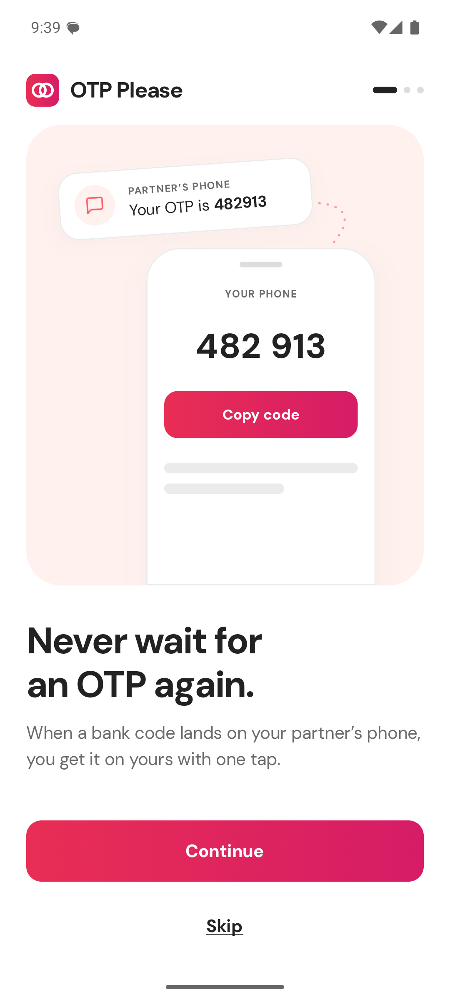
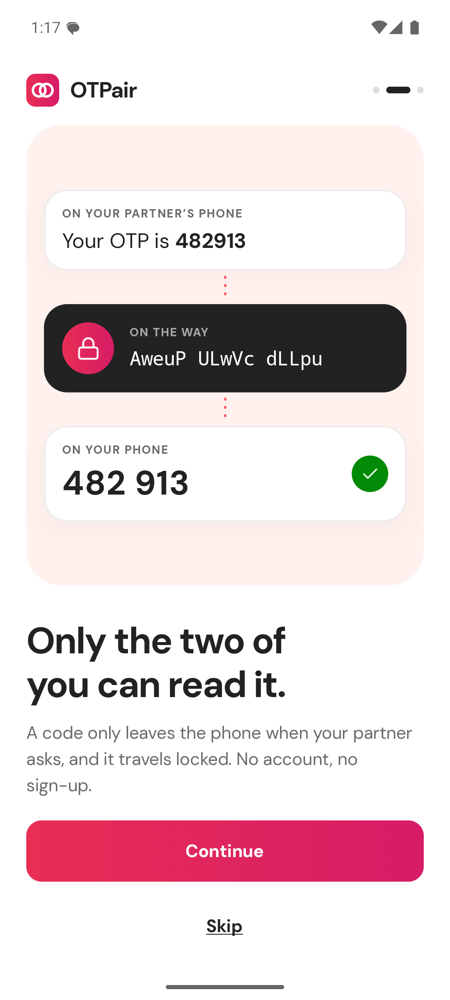
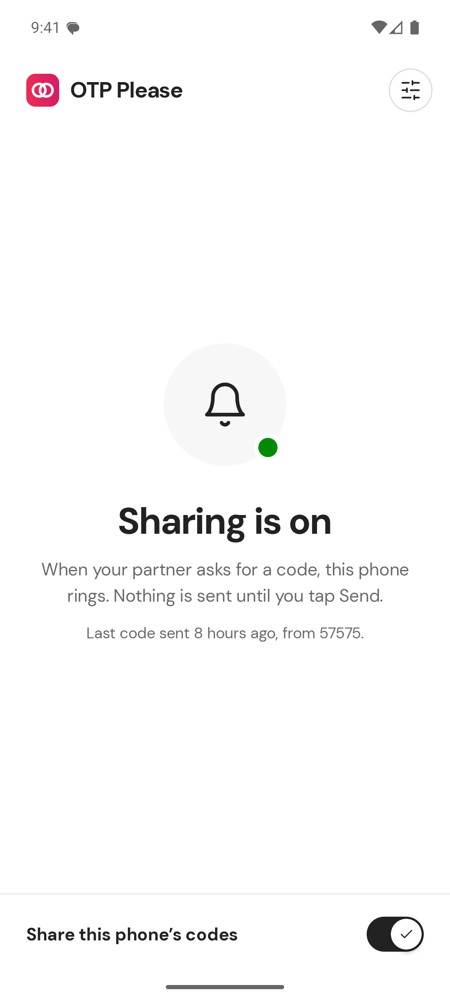
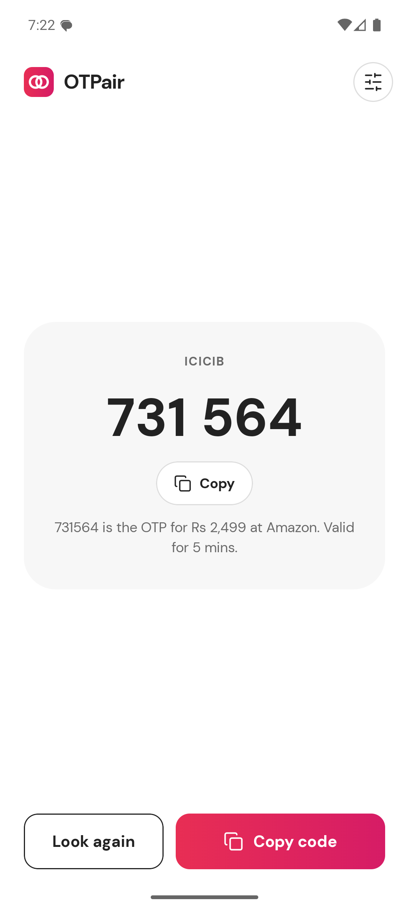

# OTP Please

**Never wait for an OTP again.** OTP Please pairs two Android phones so that either person can get the other's one-time codes with one tap.

It is built for couples and families who share cards: the card is in one person's name, the OTP lands on that person's phone, and the other person is stuck at checkout waiting for it.

<p>
  
  
  
  
</p>

## How it works

1. **Pair once, in the same room.** One phone shows a QR code, the other scans it. Both phones then show the same four-digit **pair number**. If the numbers match, you are paired with each other and nobody else.
2. **Turn on sharing** on the phone that receives the bank messages. The app first asks you to confirm that you trust the other person completely.
3. **Tap Get OTP** on the other phone. The sharing phone rings like an incoming call.
4. **Tap Send a code** on the sharing phone. When the bank's text arrives, Android shows it and asks to let OTP Please read it; tap **Allow** and the code appears on the other phone a second later. If the text came before the request, copy the code from it and tap **Paste code**. Tap **Don’t send**, or ignore it, and nothing leaves the phone.

Once paired, each phone shows only its job: the sharing phone says **Sharing is on**, the other phone shows **Get OTP**. The lock, the pair number and Unpair are under **Settings** (the sliders at the top right).

**A code leaves the phone only when your partner asks for it and you say yes.** Under the hood:

- **OTP Please cannot read your text messages.** It has no SMS permission. A message reaches it only through Android's own pop-up, "Allow OTP Please to read the message below?", which shows you the whole message first. Android offers that pop-up only for the next text with a code in it, for five minutes after a request, and only from senders not in your contacts.
- Tapping **Get OTP** sends an encrypted request that wakes the sharing phone through Firebase Cloud Messaging. The sharing phone rings like an incoming call. If the screen is off or locked, a full-screen page takes over the display. It keeps ringing until you answer, for up to five minutes.
- Only after you allow a message, or paste a code, does the phone encrypt it (AES-256-GCM) and send it. Answering needs the phone unlocked. **Don’t send** tells the other phone "not sent" and nothing else.
- Sharing does not work with notifications turned off, so a request can never go unseen.
- Requests and codes travel through [ntfy.sh](https://ntfy.sh), a free public relay. The channel name and the encryption key both come from the pairing secret, so the relay only ever sees scrambled text.

There is no account and no analytics. The only server of its own is a tiny [worker](worker/wake.js) that passes the encrypted request to Firebase.

## Install

OTP Please is on its way to the Play Store. Until then, you can build it yourself:

```bash
./gradlew assembleRelease
```

The APK is written to `build/outputs/apk/release/otp-please-release.apk`. Building needs JDK 17 or 21 and the Android SDK (platform 36). To wake the sharing phone, a build also needs a Firebase project and the worker: see [docs/PLAY.md](docs/PLAY.md).

On the phone that will **share** its codes, allow notifications when the app asks. If the app says so, also let it show full-screen notifications, so a request can take over the screen like a call.

## Security, honestly

- **Only the two paired phones can read a code.** The relay, your network and anyone watching the relay see only encrypted text. They can see *that* a request or a code was sent, and when.
- **A photo of the QR code is not a key.** The QR code holds only a public key. The two phones work out the real secret between themselves (ECDH on P-256), and it is never shown or sent. A pair is exactly two phones: if someone else scans the code first, your partner's phone fails to pair instead of quietly joining. The pairing screen cannot be screenshotted in release builds.
- **Check the pair number.** It is the same on both phones only when they hold the same secret. If your partner's number is different, someone else got in first: unpair and pair again.
- **Nothing is sent without a yes.** Every code needs you to answer on the sharing phone, unlocked, and then allow the message or paste the code yourself. Android's pop-up shows the whole message, so you see which bank, how much and where before you decide. The sharing screen shows when the last code was sent.
- **Get OTP is locked.** By default it asks for a fingerprint, face or the phone's PIN (Android 9 or newer, on a phone with a screen lock), so someone who picks up the unlocked phone cannot pull a code. You can turn this off in Settings.
- **Google sees that a phone was woken, not why.** Firebase gets the pair's Firebase topic (unrelated to the relay channel), the time, and the encrypted request.
- **Only codes that were asked for ever reach the relay.** They stay there encrypted for about 12 hours, then expire. Old messages played back are ignored: every message carries the time it was written and is refused after three minutes.
- **The secret is encrypted on the phone** with a key held in the Android Keystore, and is excluded from cloud backups and phone-to-phone transfers. A rooted or compromised phone could still use it.
- **A copied code is cleared from the clipboard after a minute**, if OTP Please is still open.
- **Your partner sees the full text of a message you allow**, not just the code, so they can check the amount and merchant. A pasted code is sent on its own.
- **Your partner can ask for a code at any time**, but each one still needs your yes.
- Banks tell you never to share OTPs. OTP Please is for people who have already decided to share a card with one person they trust completely. Do not pair with anyone else, and never install it on someone's phone without their knowledge.

## Limits

- **The sharing phone has to be with someone.** If nobody sends a code within five minutes, none is sent. Do Not Disturb can silence the ringing.
- **Android only offers texts that arrive after the request.** If the bank's text came first, copy the code from it (Google Messages puts a copy button on the notification) and tap **Paste code**, or tap **Resend OTP** where you are paying.
- **Android skips texts from senders in your contacts.** Bank codes come from short codes such as AX-HDFCBK, so this rarely matters.
- **Keep OTP Please open while you wait.** Android cuts an app's internet shortly after it leaves the screen. If you switch to the bank page and come back, OTP Please picks the code up as soon as it is in front again.
- **Both phones need roughly the right time.** Messages more than three minutes off are refused. Phones set to automatic time are fine.
- **The sharing phone needs Google Play services**, for the wake-up and Android's message pop-up.
- **Text messages only.** Codes sent over RCS chat, WhatsApp or email are not picked up.
- **The relay is someone else's free service.** If ntfy.sh is down, sharing pauses. To use your own ntfy server, change `BASE` in [`Relay.kt`](src/main/kotlin/co/atomiclabs/otpair/Relay.kt).
- **OTP detection is a heuristic** tuned on Indian bank messages (a keyword such as "OTP" or "code", plus the nearest 4 to 8 digit number). Unusual formats may be missed; add a case to [`CoreTest.kt`](src/test/kotlin/co/atomiclabs/otpair/CoreTest.kt) and adjust `Otp` in [`Core.kt`](src/main/kotlin/co/atomiclabs/otpair/Core.kt).

## Publishing a build

Without a signing key of your own, `assembleRelease` signs the APK with your computer's debug key. That is fine for your own two phones. Before you give the APK to anyone else, sign it with a key only you hold, so that nobody can pass off a changed copy as an update.

Create the key once (you choose the passwords; keep the file and the passwords safe, because losing them means you can never update the app):

```bash
keytool -genkeypair -v -keystore otpair.jks -alias otpair -keyalg RSA -keysize 4096 -validity 10000
```

Then write a `keystore.properties` file next to `build.gradle.kts`:

```properties
storeFile=otpair.jks
storePassword=…
keyAlias=otpair
keyPassword=…
```

Both files are in `.gitignore`. Never commit them. Publish the key's SHA-256 fingerprint next to your downloads so people can check an APK is yours:

```bash
keytool -list -v -keystore otpair.jks -alias otpair
```

Moving from the debug key to your own key means uninstalling the app and pairing again.

## Development

| File | What it holds |
| --- | --- |
| [`Core.kt`](src/main/kotlin/co/atomiclabs/otpair/Core.kt) | OTP detection, pairing, encryption, the message format. Pure Kotlin, unit tested. |
| [`Relay.kt`](src/main/kotlin/co/atomiclabs/otpair/Relay.kt) | The relay calls, the Firebase wake-up, stored settings (the secret is encrypted), the ringing request, Android's message pop-up and the answer handling. |
| [`worker/wake.js`](worker/wake.js) | The Cloudflare worker that hands an encrypted request to Firebase. Test: `node worker/wake.test.mjs`. |
| [`Theme.kt`](src/main/kotlin/co/atomiclabs/otpair/Theme.kt) | Colours, type, icons, buttons. |
| [`Onboarding.kt`](src/main/kotlin/co/atomiclabs/otpair/Onboarding.kt), [`Pairing.kt`](src/main/kotlin/co/atomiclabs/otpair/Pairing.kt), [`Home.kt`](src/main/kotlin/co/atomiclabs/otpair/Home.kt), [`Approval.kt`](src/main/kotlin/co/atomiclabs/otpair/Approval.kt) | The screens (Jetpack Compose). Approval.kt is the full-screen request on the sharing phone. |
| [`MainActivity.kt`](src/main/kotlin/co/atomiclabs/otpair/MainActivity.kt) | Which screen is showing. |
| [`CoreTest.kt`](src/test/kotlin/co/atomiclabs/otpair/CoreTest.kt) | Tests for detection, pairing, encryption and replayed messages. |

```bash
./gradlew testDebugUnitTest
```

To try it with a single phone or emulator, [`tools/partner.mjs`](tools/partner.mjs) plays the other phone from your computer. Use a debug build (release builds block screenshots), tap **Show my code**, and read the text out of the QR code (`otpair2:…`):

```bash
node tools/partner.mjs "otpair2:…" pair                           # pair; prints the link (otpair1:…) and the pair number
node tools/partner.mjs "otpair1:…" sealwant                       # a sealed request; ring a debug build with it:
adb shell am broadcast -n co.atomiclabs.otpair/.DebugWake --es m "$(node tools/partner.mjs "otpair1:…" sealwant)"
adb emu sms send 5551234 "OTP is 482913 for INR 1,499.00 at AMAZON"   # a bank text, for Android's pop-up
node tools/partner.mjs "otpair1:…" asking                         # as the sharing phone: "it's ringing"
node tools/partner.mjs "otpair1:…" otp 482913 HDFCBK "OTP is 482913"   # as the sharing phone: Send
node tools/partner.mjs "otpair1:…" no                             # as the sharing phone: Don’t send
node tools/partner.mjs "otpair1:…" read 60s                       # read what is on the relay
```

## License

[MIT](LICENSE). The app bundles the [DM Sans](https://github.com/googlefonts/dm-fonts) typeface under the [SIL Open Font License](licenses/DM-Sans-OFL.txt), and its icons are redrawn from [Lucide](https://lucide.dev) under the [ISC License](licenses/Lucide-ISC.txt).
